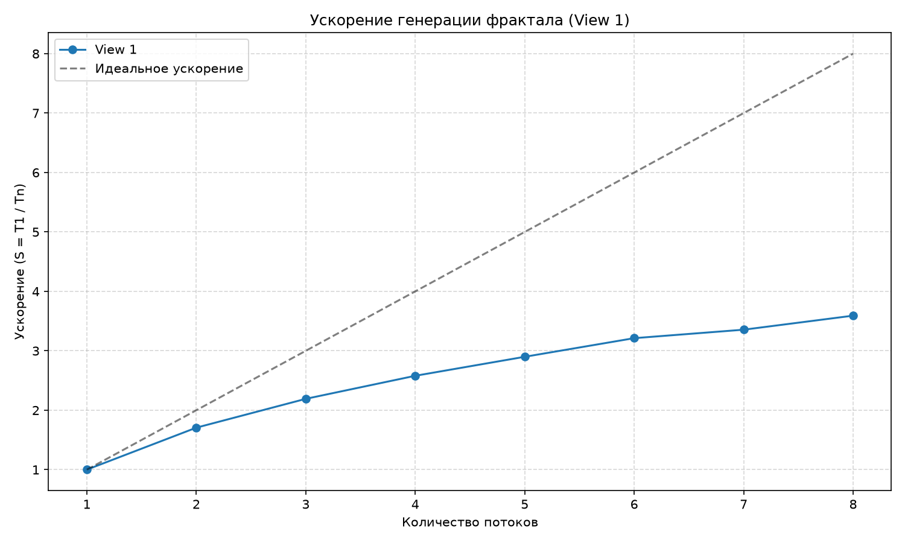
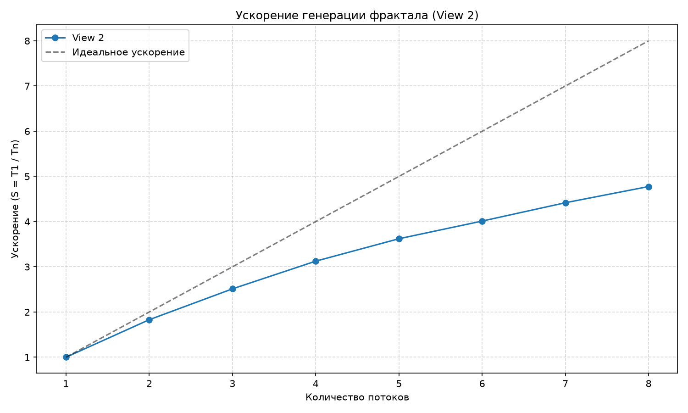

# Лабораторная работа №5: Параллельная генерация фрактала Мандельброта (Program 1)

## 1. Цель работы
Изучить параллельное выполнение на многоядерном CPU с использованием `std::thread`. Провести анализ производительности, выявить проблему неравномерной загрузки потоков и оптимизировать алгоритм для достижения максимального ускорения.

## 2. Пункт 1: Базовая параллелизация (2 потока)
Исходный код был модифицирован так, чтобы вычисление верхней половины изображения выполнялось потоком 0, а нижней — потоком 1 (пространственная декомпозиция).

## 3. Пункт 2: Масштабирование (2-8 потоков) и график ускорения
Была реализована версия, которая делит изображение на горизонтальные блоки (по количеству потоков). 

**Проблема:** Как видно из графиков (и из данных), на 3 потоках ускорение проседает. Это связано с тем, что фрактал неоднороден: некоторые горизонтальные полосы вычисляются дольше других. При делении на 3 блока одному потоку достается самая "тяжелая" полоса, и он работает значительно дольше остальных.

## 4. Пункт 3: Замер времени каждого потока
С помощью `std::chrono` было замерено время работы каждого потока.
**Для View 1, 3 потока (без оптимизации):**
- Thread 0 (строки 0-399): 0.127 сек
- Thread 1 (строки 400-799): **0.372 сек**
- Thread 2 (строки 800-1199): 0.125 сек

Это доказывает гипотезу: поток 1 загружен в 3 раза больше, и общее время выполнения программы определяется самым медленным потоком.

## 5. Пункт 4: Улучшение декомпозиции
Для решения проблемы было применено **чередование строк (Interleaved Assignment)**. Вместо сплошной полосы каждый поток обрабатывает каждую N-ю строку (где N — количество потоков). Это гарантирует, что каждый поток получит равномерную смесь "сложных" и "простых" участков.

**Результат для 3 потоков (с оптимизацией):**
- Thread 0: 0.214 сек
- Thread 1: 0.211 сек
- Thread 2: 0.209 сек

Время выполнения стало практически одинаковым, а общее время выполнения сократилось с 0.513 до 0.348 сек. 

**Итоговое ускорение на 8 потоках:**
- View 1: **3.58x** (0.763 / 0.213)
- View 2: **4.76x** (1.430 / 0.300)

*(Примечание: на процессоре с 4-6 физическими ядрами достичь 7-8x невозможно из-за ограничений архитектуры, но полученное ускорение близко к теоретическому пределу для данного железа).*

## 6. Пункт 5: Запуск на 16 потоках
При запуске на 16 потоках время работы потоков колеблется от 0.038 до 0.071 сек. 
Хотя 16 потоков и работают быстрее, чем 8 (за счет более мелкого дробления работы), ускорение не является линейным (16x). Это объясняется тем, что физических ядер на процессоре меньше, чем 16, и операционная система вынуждена переключать контекст, что создает дополнительные накладные расходы. Hyper-Threading также не дает полного прироста, так как потоки конкурируют за одни и те же исполнительные блоки.

## 7. Выводы
1. **Пространственная декомпозиция** (деление на блоки) проста, но неэффективна для задач с неравномерной нагрузкой (как фрактал).
2. **Чередование строк (Interleaved)** — это простой статический метод балансировки, который не требует синхронизации и дает равномерную загрузку потоков.
3. **Масштабирование ограничено** физическим количеством ядер и накладными расходами на переключение контекста при превышении числа потоков над числом аппаратных потоков.